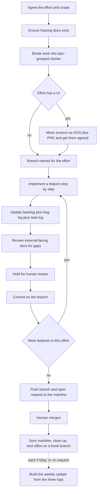

# Workflow

The repeatable process for doing a unit of work with the agent. Read these in
order; they describe one full loop from "where do docs live" through "open the
request."

## Contents

| # | Doc | What's in it |
|---|-----|--------------|
| [01](./01-docs-structure.md) | The Docs Structure | The standard `docs/` taxonomy, publish compliance, and the create-the-docs-before-the-effort rule (and what to do when something emerges mid-effort) |
| [02](./02-effort-model.md) | The Effort Model | What an "effort" is (a product-guided feature or capability), branch naming, and step-by-step commits |
| [03](./03-backlog-and-logs.md) | Backlog & Logs | The epic → feature → story format, the exact formats of the task-log, bug-log and design-decision-log, when each is written, and the pre-commit routine |
| [04](./04-scaffolding-and-main.md) | Scaffolding & mainline | Initial scaffold is a chore merged straight to the mainline; everything after is branch + request |
| [05](./05-review-and-publish.md) | Review & Publish | Hold-for-review, the color-coded diff, external-content review, the request to the mainline, and the CI gate |
| [06](./06-ui-mockups.md) | UI Mockups | For UI efforts only: mock the screens as SVG + PNG pairs under `product/mockups/` and get them agreed before writing UI code |
| [07](./07-weekly-updates.md) | Weekly Updates | On request (ideally each Friday): build a dated stakeholder update from the task-log, bug-log and design-decision-log, with a fixed template under `product/updates/` |
| [08](./08-deep-scan.md) | The Deep Scan | On request, or after a major change the agent suggests: find docs that no longer match the project. Code does the mechanical checks; the agent does the judgment and proposes the decisions; one report per repository |

## The loop at a glance

## Related

- [00 — Working Relationship](../00-working-relationship.md) — the contract these steps serve
- [decisions/](../decisions/README.md) — where design decisions made during an effort are captured
- [directives/](../directives/README.md) — hard rules that apply throughout
