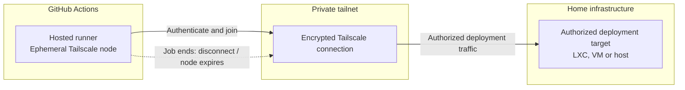

# Design Decision Log

[Back to Backlog Index](./README.md)

Lightweight design decisions; see the [decision policy](../../ai/decisions/README.md).

## Open Decisions

| ID | Question | Area | Status | Raised | Related |
|----|----------|------|--------|--------|---------|
| D04 | How will Docker be provisioned and secured on the Proxmox-managed LXC? | Deployment | deferred | 2026-11-19 | [T01](./task-log.md) |

## Decided

| ID | Question | Decision | Rationale | Decided on |
|----|----------|----------|-----------|------------|
| D06 | How should custom Gmail labels relate to Archive cleanup? | Discover and offer custom labels separately in a future effort; Archive still includes eligible custom-labeled mail. | Keeps the established Archive behavior while letting users select additional labels explicitly. | 2026-11-19 |
| D05 | How are account tokens stored for local use and scripting? | Use macOS Keychain for web-connected accounts; allow explicit environment or `.env` credential injection for CLI automation. | Supports interactive multi-account OAuth and scheduled CLI use without requiring plaintext token storage for the web UI. | 2026-11-19 |
| D03 | How does cleanup handle multiple accounts? | Connect multiple Google accounts and select one account for each preview and cleanup. | Keeps account boundaries visible and supports navigating each account's mailboxes. | 2026-11-19 |
| D02 | How should the web UI be designed? | Review SVG and PNG mockups before UI code. | Keeps the screen and interaction model subject to human review. | 2026-11-19 |
| D01 | What messages are archived, and how are they recovered? | Select archived received mail and move eligible messages to Gmail Trash; recover in Gmail. | Limits accidental deletion and uses Gmail's native recovery path. | 2026-11-19 |

## Details

### D06 — Custom labels and Archive — DECIDED

- **Area:** Gmail cleanup.
- **Considerations:** Messages may have several labels; Inbox and Archive
  already select whole messages, not independent folders.
- **Options:** Include eligible custom-labeled messages in Archive (chosen);
  exclude them unless their label is selected (not selected).
- **Decision:** Preserve Archive's current inclusion of eligible custom-labeled
  messages. Discover account-specific custom labels in a separate future
  effort, with additional labels initially unchecked.
- **Consequences:** Unchecking a custom label does not protect matching messages
  from Inbox or Archive cleanup. The future UI and CLI must state this and
  deduplicate overlapping message selections.
- **Related:** [T01](./task-log.md), [E3](./E3-custom-label-selection.md), D01.

### D05 — Local OAuth credentials and CLI automation — DECIDED

- **Area:** Authentication and CLI.
- **Considerations:** Multiple accounts need separate OAuth authorization; the
  web UI should use Google's account chooser; scheduled scripts need noninteractive
  access. Refresh tokens require protection.
- **Options:** macOS Keychain for web accounts with explicit environment injection
  for CLI (chosen); plaintext `.env` for all account tokens (rejected for web);
  session-only tokens (rejected because scheduled runs must work after restarts).
- **Decision:** Save web-connected account tokens in macOS Keychain, overriding
  the `.env`-only secrets directive for that storage. Support explicit CLI
  credential injection via environment or `.env`; do not log secrets.
- **Consequences:** Keychain depends on macOS and may require unlock or permission;
  injected `.env` values remain plaintext. Google authorization and token
  validity are prerequisites. Linux deployment is deferred to D04.
- **Related:** [T01](./task-log.md), [E1](./E1-first-epic.md).

### D04 — Proxmox LXC Docker deployment — DEFERRED

- **Area:** Deployment.
- **Raised:** 2026-11-19.
- **Considerations:** Docker on a Proxmox-managed LXC, provisioning, configuration,
  persistent account credentials on Linux, and secure remote access. The shared
  deployment server uses nginx and Authentik; local development does not use a proxy.
- **Status:** Deferred at the user's request until the application runs in local
  development. The user will explain the provisioning and configuration process.
- **Considered for later discussion:** the existing custom deployment stack and
  GitHub Actions alternatives, including the official Tailscale action. Compare
  provisioning, access controls, authentication, secret storage, persistent
  user settings, recovery, deployment approvals and rollback. No approach has
  been selected. In particular, a temporary runner node does not by itself
  eliminate the need to protect credentials or authorize deployment.
- **Example candidate, not an approved architecture:** a GitHub-hosted runner
  joins the private tailnet as an ephemeral node, accesses a suitably authorized
  home deployment target, and leaves or expires after the job. The target might
  be an LXC, VM, or another host; its identity and transport remain undecided.

- **Reference:** [Tailscale's GitHub CI/CD guidance](https://tailscale.com/docs/solutions/connect-github-cicd-workflows-to-private-infrastructure-without-public-exposure).
  Tailnet grants should restrict destinations and ports; the identity and
  credentials used by the action must be selected and protected.
- **Related:** [T01](./task-log.md), [E2](./E2-user-settings.md).

### D03 — Navigate multiple Google accounts — DECIDED

- **Area:** Gmail cleanup and web UI.
- **Considerations:** The user needs to connect several accounts and navigate each
  account's Inbox and Archive with the requested defaults; a cleanup must not
  silently affect a different account.
- **Options:** Select and preview one account at a time (chosen); combine all
  accounts into a single cleanup (not requested and harder to review safely).
- **Decision:** Show the active account and its mailboxes, and name the account in
  preview and confirmation. Provide account selection for CLI operations as well.
- **Consequences:** Each account's cleanup is reviewed separately; account setup
  and authorization must support more than one account.
- **Related:** [T01](./task-log.md), [E1](./E1-first-epic.md).

### D02 — Mockups before UI code — DECIDED

- **Area:** Web UI.
- **Considerations:** The user needs to review cleanup and credential setup before implementation.
- **Options:** Reviewed mockups (chosen); implement first and revise afterward (rejected because the project's workflow requires review first).
- **Decision:** Present [cleanup and admin mockups](../mockups/README.md) for approval before UI coding.
- **Consequences:** UI implementation waits for review; mockups remain durable design artifacts.
- **Related:** [T01](./task-log.md), [E1](./E1-first-epic.md).

### D01 — Archive selection and recovery — DECIDED

- **Area:** Gmail cleanup.
- **Considerations:** Gmail has no archive folder; deletion must be recoverable.
- **Options:** Archived received mail (chosen); all non-inbox mail including sent messages (rejected as broader). Recover in Gmail Trash (chosen); add recovery to this tool (not selected).
- **Decision:** Exclude Inbox, Sent, Drafts, Spam and Trash from archive selection and move matching messages to Trash, not permanent deletion.
- **Consequences:** Gmail provides recovery subject to its retention and account policies.
- **Related:** [T01](./task-log.md), [E1](./E1-first-epic.md).
